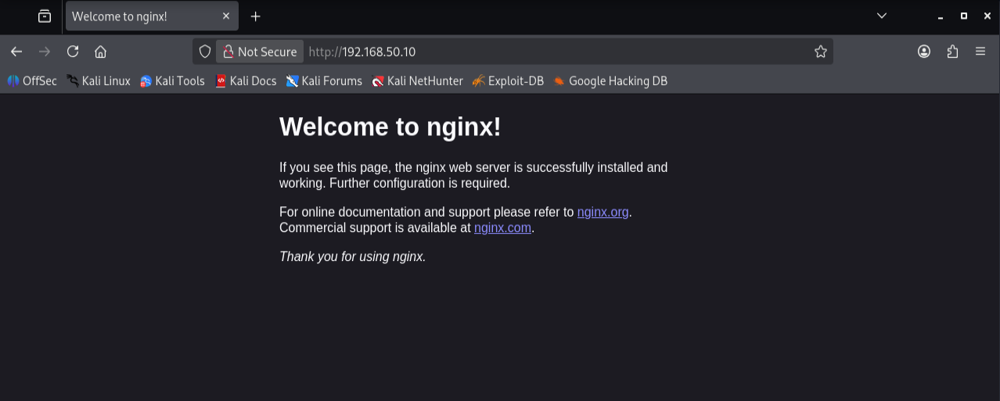
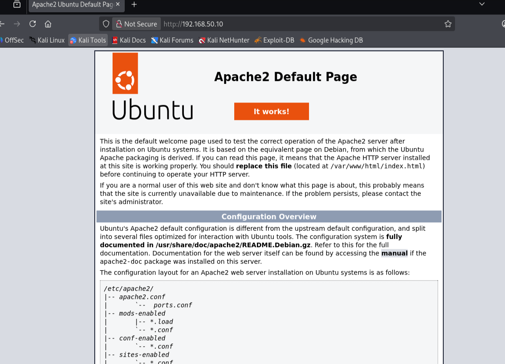
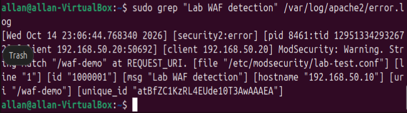
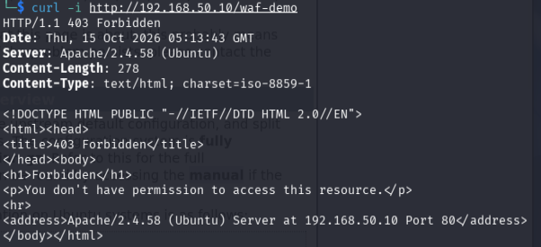
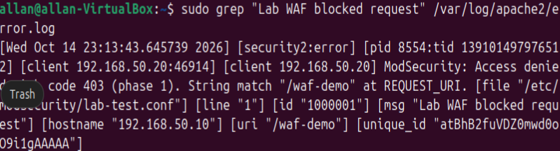
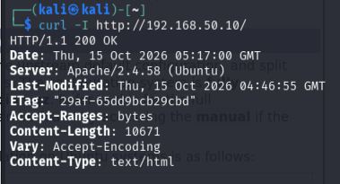
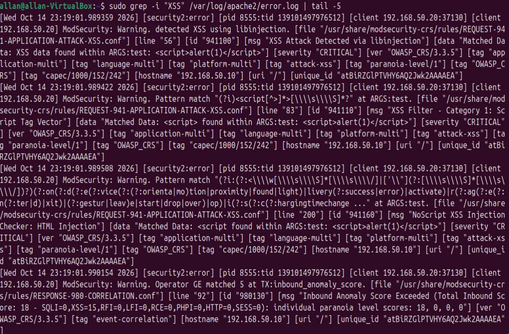
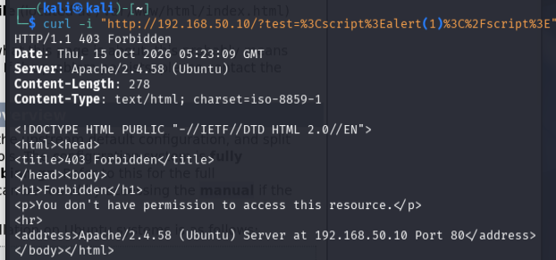

# linux-waf-attack-defense-homelab
Built an isolated Kali Linux and Ubuntu security lab using Apache, ModSecurity, and the OWASP Core Rule Set. Simulated suspicious HTTP traffic, analyzed WAF detection logs, configured blocking rules, and verified that legitimate traffic remained accessible.
# Linux Web Application Firewall (WAF) — Attack & Defense Homelab

## Project Overview

Built an isolated cybersecurity homelab using Kali Linux and Ubuntu in Oracle VirtualBox to simulate suspicious HTTP traffic and investigate how a Web Application Firewall (WAF) detects and blocks requests.

Configured Apache, ModSecurity, and the OWASP Core Rule Set (CRS) to demonstrate web application protection, security event logging, and defensive verification.

The project focuses on understanding both the attacker's perspective and the defender's response in a controlled environment.

## Lab Environment

| Component | Configuration |
|---|---|
| Virtualization | Oracle VirtualBox |
| Test Client | Kali Linux |
| Web Server | Ubuntu 24.04 |
| Web Server Software | Apache 2.4 |
| Web Application Firewall | ModSecurity 2.9.7 |
| Security Rules | OWASP Core Rule Set 3.3.5 |
| Network Type | Internal Network (SecurityLab) |
| Kali IP | 192.168.50.20 |
| Ubuntu IP | 192.168.50.10 |
| Web Service | HTTP (Port 80) |

Both virtual machines also used separate NAT adapters for internet access and software installation.

## 1. Network Configuration

Configured two network adapters on both virtual machines:

- **Adapter 1:** NAT for internet access.
- **Adapter 2:** Internal Network named `SecurityLab` for communication between Kali and Ubuntu.

Assigned static IP addresses to the isolated interfaces.

**Kali Linux:** `192.168.50.20/24`

**Ubuntu:** `192.168.50.10/24`

Verified connectivity using the `ping` command in both directions.

This established a dedicated test network for the security exercises.

## 2. Web Server Setup

Initially installed Nginx on Ubuntu to verify HTTP connectivity.

From Kali Linux, accessed the Ubuntu web server through:

`http://192.168.50.10`

Successfully loaded the default Nginx welcome page.

Later switched to Apache to use the available ModSecurity Apache integration.

Installed and started Apache, then verified that Kali could access the default Apache webpage.

## 3. ModSecurity WAF Configuration

Installed and configured the following security components:

- Apache HTTP Server
- ModSecurity Web Application Firewall
- OWASP Core Rule Set

Enabled the ModSecurity Apache module and verified that it loaded successfully.

Created the ModSecurity configuration file and initially configured the WAF in `DetectionOnly` mode.

This allowed suspicious requests to be detected and logged before enabling blocking.

Verified the Apache configuration using:

`sudo apache2ctl configtest`

The configuration test returned `Syntax OK`.

## 4. Custom WAF Rule — Detection Test

Created a custom ModSecurity rule to detect requests targeting a specific test URL.

**Test endpoint:** `/waf-demo`

Configured the rule to log matching requests without blocking them.

From Kali Linux, generated a request using:

`curl -i http://192.168.50.10/waf-demo`

Examined Apache's error log on Ubuntu and confirmed that ModSecurity recorded the request.

**Detection results:**

- Source IP: `192.168.50.20`
- Destination IP: `192.168.50.10`
- Rule ID: `1000001`
- Detection message: `Lab WAF detection`

## 5. Custom WAF Rule — Blocking Test

Changed the ModSecurity engine from `DetectionOnly` to `On`.

Updated the custom rule to reject requests to `/waf-demo` with HTTP status `403`.

Repeated the request from Kali Linux.

**Result:** `HTTP/1.1 403 Forbidden`

This demonstrated the difference between detecting suspicious requests and actively blocking them.

## 6. Security Log Investigation

Reviewed Apache's security logs to verify the blocking event.

Used:

`sudo grep "Lab WAF blocked request" /var/log/apache2/error.log`

Confirmed that ModSecurity logged the denied request.

The log identified the matching rule and originating client.

## 7. Normal Traffic Verification

Tested whether legitimate HTTP traffic could still reach the web server after enabling the WAF.

From Kali Linux, ran:

`curl -I http://192.168.50.10/`

**Result:** `HTTP/1.1 200 OK`

This confirmed that the website remained accessible while the custom test endpoint was blocked.

## 8. OWASP Core Rule Set — XSS Detection

Tested the built-in OWASP CRS using a controlled HTTP request containing an encoded JavaScript-like string.

The request was sent to the Ubuntu web server from Kali Linux.

Reviewed the Apache security logs and confirmed multiple OWASP CRS detections.

| Rule ID | Detection |
|---|---|
| 941100 | XSS Attack Detected via libinjection |
| 941110 | XSS Filter — Script Tag Vector |
| 941160 | NoScript XSS Injection Checker |
| 980130 | Inbound Anomaly Score Exceeded |

The WAF recorded an **inbound anomaly score of 18**, exceeding the configured blocking threshold.

This demonstrated how the OWASP Core Rule Set identifies suspicious patterns and evaluates request risk.

## 9. OWASP CRS — Attack Blocking

Repeated the controlled XSS test request from Kali Linux.

**Result:** `HTTP/1.1 403 Forbidden`

The request was rejected by the protected web server.

This confirmed that the OWASP CRS was actively enforcing security rules, rather than only logging suspicious activity.

## 10. Final Verification

After completing the OWASP CRS blocking test, verified normal website accessibility again.

**Normal HTTP request:** `200 OK`

**Suspicious test request:** `403 Forbidden`

The tests demonstrated that the WAF could block the controlled suspicious request while keeping the normal webpage available.

## Skills Demonstrated

- Linux system administration
- Oracle VirtualBox networking
- Static IP address configuration
- Network connectivity troubleshooting
- Apache web server administration
- HTTP request and response analysis
- Web Application Firewall configuration
- ModSecurity rule management
- OWASP Core Rule Set
- Cross-Site Scripting (XSS) detection concepts
- Security log analysis
- HTTP 200 and 403 status interpretation
- Defensive security testing

## Key Takeaways

This project helped me understand how a Web Application Firewall protects web applications by inspecting incoming HTTP requests.

I learned how to configure ModSecurity, create a custom detection rule, investigate security events, and enable request blocking.

Testing the OWASP Core Rule Set demonstrated how predefined security rules identify suspicious patterns and contribute to anomaly scoring.

Most importantly, I practiced verifying both security and availability: blocking unwanted test requests while confirming that legitimate website traffic continued to work.

**Note:** All testing was conducted against my own isolated virtual machines. The exercise demonstrated WAF detection and prevention, not a successful compromise of the web server.
